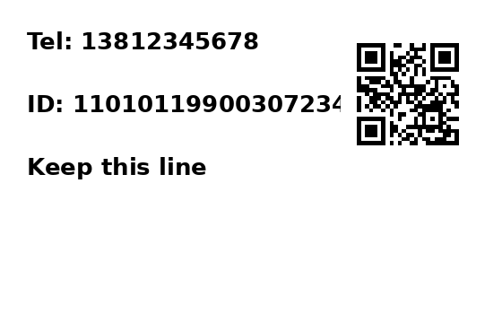
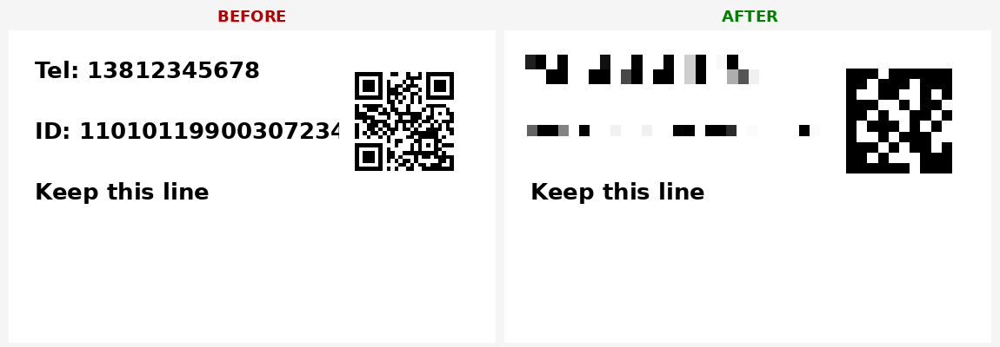

## 项目说明
本项目是使用Python来调用微信本地ocr模型，调用方法完全由[QQImpl](https://github.com/EEEEhex/QQImpl)翻译过来。也就是说该项目只是将原C++代码翻译成了纯Python实现。

**现已支持跨平台**: Windows / Linux / macOS (统一使用微信 4.x 协议)。

**支持能力**: 文字识别 (OCR) + 二维码识别 (内容与角点坐标) + 敏感信息打码。

#### 版本升级与协议自检

微信大版本更新后协议可能漂移（请求 id、消息字段、错误码行为等），先跑自检：

```bash
PYTHONPATH=. python3 tools/verify_protocol.py     # P1-P9 黑盒探针, 任一失败即漂移
```

- 探针定义与失败后的重推步骤见 [`docs/PROTOCOL.md`](docs/PROTOCOL.md)
  （协议唯一事实源：消息表、字段布局、RGBA 格式、静态/黑盒重推手法）
- 当前协议验证基线：**4.1.13.26**（`ocr_manager.PROTOCOL_VERIFIED_VERSION`，
  由 `config.detect_wechat_version()` 三平台探测版本对照）
- P3 顺带校验 `rate ∈ [0,1]`（swigger/wechat-ocr#52 报告的 rate>1 是旧测试版
  上 pb 解析错位的症状，4.1.13 实测同图多次识别完全确定性）

#### 温馨提示

该项目自己玩玩就行，不要用于商业用途

## 使用说明

#### 安装

本项目未发布到 PyPI, 请直接从 GitHub 安装:

```bash
# pip
pip install git+https://github.com/dwdcth/wechat_ocr.git
# 或 uv
uv pip install git+https://github.com/dwdcth/wechat_ocr.git
# 或作为项目依赖 (pyproject.toml)
#   dependencies = ["wechat-ocr @ git+https://github.com/dwdcth/wechat_ocr.git"]
uv add git+https://github.com/dwdcth/wechat_ocr
```

也可以不安装直接运行:

```bash
uv run --with git+https://github.com/dwdcth/wechat_ocr --with protobuf python your_script.py
```

#### 依赖(必要条件)

1. Windows / Linux / macOS 系统
2. 已安装微信 4.x (Linux 为 wechat-universal 等发行版, macOS 为 WeChat.app)
3. Python 3.12+, 以及 `protobuf`

#### 微信路径解析

库会按以下顺序解析微信安装路径 (即包含 `mmmojo` 动态库与 `WeChatOCR`/`wxocr` 可执行文件的目录):

1. **显式传参**: `OcrManager(wechat_path)`
2. **环境变量**: `WECHAT_OCR_DIR` / `WECHAT_OCR_EXE` / `WECHAT_OCR_MMMOJO`
3. **配置文件** (JSON):
   - Linux/macOS: `~/.config/wechat_ocr/config.json` (或 `$XDG_CONFIG_HOME/wechat_ocr/config.json`)
   - Windows: `%APPDATA%\wechat_ocr\config.json`
   - 可用环境变量 `WECHAT_OCR_CONFIG` 直接指定配置文件完整路径

   ```json
   {
       "wechat_dir": "/opt/wechat-universal",
       "ocr_exe_path": "/opt/wechat-universal/wxocr",
       "mmmojo_path": "/opt/wechat-universal/libmmmojo.so"
   }
   ```

   只填 `wechat_dir` 即可，其余两项会在该目录下自动查找。
4. **常见路径自动探测**:
   - Windows: `C:\Program Files\Tencent\WeChat` 等
   - Linux: `/opt/wechat-universal`、`/opt/wechat` 等
   - macOS: `/Applications/WeChat.app`

#### 示例

完整可运行示例在 [example/](./example/) 目录, 附带测试图, 仓库目录下即可直接跑:

| 示例 | 说明 |
|---|---|
| [example/1_ocr.py](example/1_ocr.py) | 基础文字识别: 回调结果结构、文本内容、置信度与位置框 |
| [example/2_qrcode_barcode.py](example/2_qrcode_barcode.py) | 二维码识别 (解码内容 + 四角点坐标, 支持一图多码) 与条形码 (EAN-13 等数字行提取) |
| [example/3_mosaic.py](example/3_mosaic.py) | 敏感信息打码: 内置正则 (手机号/身份证/邮箱) + 二维码区域, 三种样式 |
| [example/4_async.py](example/4_async.py) | asyncio 门面: await 即得结果, 批量并发 (≤32) + 零拷贝 RGBA |
| [example/5_protocol_async.py](example/5_protocol_async.py) | 协议级异步: 提交即返回, 结果按完成顺序流入回调, WaitDone 收尾 |

```bash
uv run --with protobuf python example/1_ocr.py               # 基础文字识别
uv run --with protobuf python example/2_qrcode_barcode.py    # 二维码 / 条形码
uv run --with protobuf --with pillow python example/3_mosaic.py  # 敏感信息打码
```

最简用法:

```python
import time
from wechat_ocr.ocr_manager import OcrManager, OCR_MAX_TASK_ID

results = {}

def ocr_result_callback(img_path: str, r: dict):
    results[img_path] = r
    for item in r.get("ocrResult", []):
        print(item["text"])          # 文字 (条形码数字也在这里)

def main():
    # 微信路径解析顺序: 显式传参 > 环境变量 > 配置文件 > 自动探测
    #   - Windows: OcrManager(r"C:\Program Files\Tencent\WeChat")
    #   - Linux:   OcrManager("/opt/wechat-universal")
    #   - macOS:   OcrManager("/Applications/WeChat.app")
    ocr_manager = OcrManager()
    ocr_manager.SetOcrResultCallback(ocr_result_callback)
    ocr_manager.StartWeChatOCR()
    ocr_manager.DoOCRTask("test_img/1.png")
    while ocr_manager.m_task_id.qsize() != OCR_MAX_TASK_ID:
        time.sleep(0.1)
    ocr_manager.KillWeChatOCR()


if __name__ == "__main__":
    main()
```

二维码结果在 `r["qrcode"]` (解码内容 + 四角点坐标), 完整用法见 [example/2_qrcode_barcode.py](example/2_qrcode_barcode.py)。

#### 字节流识别

两种方式（`SetOcrResultCallback` 的回调都会收到结果）：

**① 零拷贝 Shared 通路（推荐，微信自身截图 OCR 同款，4.1.13 实测逆向）**：

```python
from PIL import Image
img = Image.open("x.png").convert("RGBA")
ocr_manager.DoOCRTaskShared(img.tobytes(), *img.size)   # RGBA8888 原始像素
```

协议（`method=kMMShared` + `request_id=10018`）：request 缓冲区装 RGBA8888
像素（w×h×4），attach 缓冲区装 `ParseOCRReqSharedMessage` 元数据
`{2:宽, 3:高, 4:rt{t1,t2}}`；响应仍是普通 10011 推送，`task_id=0`。
详见 `proto/ocr_wx4.proto` 注释与 `ocr_manager.shared_ocr_meta_pb`。

**② 编码图字节流（临时文件兜底）**：

```python
ocr_manager.DoOCRTaskData(image_bytes, suffix=".png")   # 返回临时文件路径
```

先落临时文件再以绝对路径提交（10010 通路只认 `pic_path`，`pic_data` 是死
字段，见 `proto/ocr_wx4.proto` 注释），回调后自动清理；`KillWeChatOCR`
会清理未完成的残留。Linux 下临时文件落 `/tmp`（通常为 tmpfs）。

#### 协议级异步（提交即返回，回调收结果）

mojo 消息天然异步（对应 swigger/wechat-ocr 的 `doOCR(path, nullptr)` +
`wait_done()` 模式）：`DoOCRTask`/`DoOCRTaskData`/`DoOCRTaskShared` 都是
**非阻塞提交**，结果经 10011 推送按完成顺序流入 `SetOcrResultCallback`
设置的回调。路径版在途上限 32（任务队列），Shared 版同刻仅 1。

```python
ocr_manager.SetOcrResultCallback(cb)            # 每张完成即回调
ocr_manager.DoOCRTasks(paths)                   # 批量提交, 队列满自动背压
ocr_manager.DoOCRTaskShared(rgba, w, h)         # 可穿插零拷贝任务
ok = ocr_manager.WaitDone(timeout=30)           # 收尾: 等全部在途完成
n = ocr_manager.PendingCount()                  # 当前在途数
```

完整示例见 [example/5_protocol_async.py](example/5_protocol_async.py)。

#### asyncio 门面（await 语法糖）

`AsyncOcrManager` 在协议级异步之上包了 `await`（原生线程回调经
`call_soon_threadsafe` 回填 Future）：

```python
from wechat_ocr.ocr_manager import AsyncOcrManager

mgr = AsyncOcrManager()
mgr.StartWeChatOCR()

r1 = await mgr.ocr_path("a.png")                 # 路径版, 可并发 (≤32)
r2 = await mgr.ocr_bytes(png_bytes)              # 编码图字节流, 可并发
r3 = await mgr.ocr_rgba(rgba_bytes, w, h)        # 零拷贝, 协议限制串行
rs  = await mgr.ocr_paths(["a.png", "b.png"], concurrency=8)   # 批量
```

限制：`ocr_rgba` 的 Shared 协议响应 `task_id` 恒为 0（无关联字段），内部用
`asyncio.Lock` 串行化；`ocr_path`/`ocr_bytes` 以 pic_path 作关联键，同一路径
并发提交会相互抢占。完整示例见 [example/4_async.py](example/4_async.py)。

顺带修掉的上游 bug：`GetIdleTaskId` 队列满时 `queue.Empty` 直接抛出（上游
`if not _id` 的"队列已满"提示分支永远到不了），现接住返回 `None` 走提示路径。

#### 敏感信息打码

基于识别结果对手机号 / 身份证 / 邮箱 / 二维码等区域自动打码 (纯 Pillow 实现):

```bash
# 安装 (含打码依赖 Pillow)
pip install "wechat-ocr[mosaic] @ git+https://github.com/dwdcth/wechat_ocr.git"
```

```python
import time
from wechat_ocr.ocr_manager import OcrManager, OCR_MAX_TASK_ID
from wechat_ocr.mosaic import apply_mosaic

results = {}
ocr_manager = OcrManager()
ocr_manager.SetOcrResultCallback(lambda p, r: results.update(r))
ocr_manager.StartWeChatOCR()
ocr_manager.DoOCRTask("screenshot.png")
while ocr_manager.m_task_id.qsize() != OCR_MAX_TASK_ID:
    time.sleep(0.1)
ocr_manager.KillWeChatOCR()

img = apply_mosaic(
    "screenshot.png", results,
    patterns="default",   # 内置正则: 手机号/身份证/邮箱; 也可传自定义正则列表
    qrcode=True,          # 二维码区域一并打掉
    style="pixel",        # pixel 马赛克 | blur 高斯模糊 | solid 纯色
)
img.save("masked.png")
```

完整示例见 [example/3_mosaic.py](example/3_mosaic.py), 打码前后效果:  → 

#### 运行结果


#### 识别结果格式 (微信 4.x 协议)

```json
{
  "taskId": 2,
  "errcode": 0,
  "width": 300,
  "height": 60,
  "ocrResult": [
    {
      "text": "你好世界",
      "rate": 0.99,
      "location": {"left": 8.0, "top": 18.0, "right": 202.0, "bottom": 52.0}
    }
  ],
  "qrcode": [
    {
      "text": "https://github.com/dwdcth",
      "type": 19,
      "corners": {
        "topleft": {"x": 33.0, "y": 34.0},
        "topright": {"x": 247.0, "y": 34.0},
        "bottomright": {"x": 247.0, "y": 248.0},
        "bottomleft": {"x": 33.0, "y": 248.0}
      }
    }
  ]
}
```

说明:
- `ocrResult`: 文字识别结果; 条形码 (EAN-13 等) 的数字也会作为文本行出现在这里
- 识别文本中 OCR 偶有漏字 (如身份证末位), 打码区域按整行文本框处理, 不影响遮盖效果
- `qrcode`: 二维码/小程序码识别结果, 仅当图片中含码时返回; `corners` 为四个角点像素坐标,
  可用于打码/贴图处理
  - `type=19` (`QR_CODE`): 普通二维码, `text` 为解码内容
  - `type=22` (`VQR_CODE`): **微信小程序码 (菊花码)**, `text` 为引擎解出的原始载荷
    (跳转信息需微信服务端解析, 微信自己扫码拿到的也是这个原始串)
  - 一张图可同时返回文字与多个码

> 注: 本版本统一使用微信 4.x 的 `ParseOCRReqMessage/ParseOCRRespMessage` 协议
> (request id: 10010/10011), 不再支持微信 3.x 的旧协议。
> 请求中的 `pic_data` 字段实测无法单独使用 (返回 err=4), 请始终使用 `pic_path` 传图片绝对路径。

## 感谢

https://github.com/EEEEhex/QQImpl
https://github.com/swigger/wechat-ocr (Linux/macOS 协议参考)
